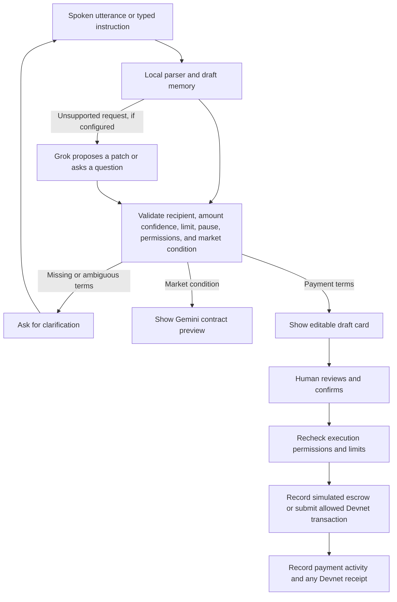
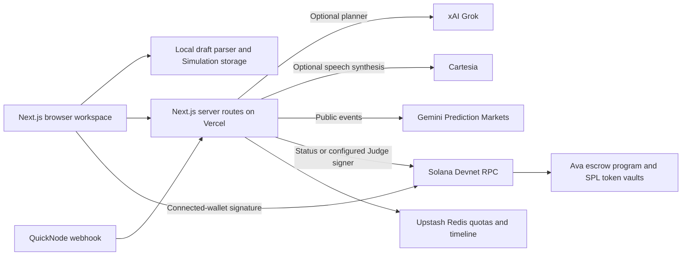

# Ava

Ava is a voice-first assistant for conditional USDC escrow. Say or type who to pay, how much to hold, and when to release it. Ava drafts the terms for review. The public demo lets judges complete the flow in Simulation without a wallet.

## Hackathon submission

| Item | Details |
| --- | --- |
| Track | Agentic Payments and AI |
| Chain award | Best use of Solana |
| Bounties entered | Pending team confirmation. The integrations below describe the code. |
| Live demo | [Ava](https://ava-puce-xi.vercel.app) |
| Demo video | Pending upload. Replace this placeholder with the public video link. |
| Source repository | [Dioscurias/ava](https://github.com/Dioscurias/ava). An unauthenticated check returned HTTP 404 on November 20, 2026. Confirm judge access before submitting. |

### Judge walkthrough

1. Open [Ava](https://ava-puce-xi.vercel.app) and select **Talk to Ava**. Use **Speak** on a browser that supports dictation, or type the request.
2. In **Simulation**, choose **Hold a payment**, or send “Hold 75 USDC for Maya Chen until I approve the design files.” Review the recipient, amount, and release condition. Try “make it 60 instead” to edit the draft.
3. Select **Confirm demo escrow** and open its detail page. Select **Mark condition met**, then **Release funds**, confirming each action. The escrow timeline and **Activity** record the result.
4. In **Settings**, pause the agent and try confirming another draft. Resume the agent to continue.
5. Send **Check Solana Devnet** to query live chain status. Try **Hold 5 USDC for Dave until the next BTC 5-minute round settles up** for a Gemini market preview, subject to active market availability.

## What’s real today

| Surface | Status |
| --- | --- |
| Simulation | Browser-local escrow, balance, and history. Funding and release are simulated. Wallet and provider keys are optional. |
| Solana Devnet reads | On November 20, 2026, the public [Devnet status API](https://ava-puce-xi.vercel.app/api/devnet/status) returned a healthy RPC, confirmed the six-decimal classic SPL USDC mint, and reported no configured program. |
| Wallet-signed and sponsored Devnet writes | Implemented in the source and exercised on a local Solana validator using a test mint fixture. The public demo has no executable Ava program configured. A public Devnet round trip and its transaction signatures remain unverified. |
| Timed escrow | Available in the connected-wallet code and exercised on the local validator. It is pending public Devnet deployment. The sponsored Judge path uses manual attestation. |
| Gemini, voice, and Grok | Code integrates the live providers described below. Market conditions are preview-only. Production synthesis, planner availability, and current Gemini quotes were not independently verified for this submission check. |
| QuickNode | Stream filter, authenticated webhook, RPC verification, and Redis-backed timeline are implemented. Live QuickNode delivery remains unverified. See the [Streams runbook](docs/quicknode-streams.md). |

## Agent decision loop



The parser handles common payment instructions, corrections, and undo. The app checks whether a planner-proposed amount appears as a literal or supported spoken amount in the request. A partial match to an existing recipient requires confirmation. Grok receives the current draft and up to four recent exchanges when the fallback planner is used. It can propose draft edits or ask questions. Signing happens separately after user confirmation.

## How we use Solana

- [Reserved Ava escrow program ID](https://explorer.solana.com/address/5oMajWiEnnKTELiZoBAWzqVeKXiQdrJ4PtFP8L82MeBB?cluster=devnet) · `5oMajWiEnnKTELiZoBAWzqVeKXiQdrJ4PtFP8L82MeBB`. Deployment is pending. The address is not evidence of a deployed program.
- [Circle Devnet USDC mint](https://explorer.solana.com/address/4zMMC9srt5Ri5X14GAgXhaHii3GnPAEERYPJgZJDncDU?cluster=devnet) · `4zMMC9srt5Ri5X14GAgXhaHii3GnPAEERYPJgZJDncDU`, six decimals, classic SPL Token Program.

The [native Rust program](program/src/lib.rs) and [TypeScript transaction builders](lib/devnet.ts) share a byte-level instruction format. This repo uses Solana's native entrypoint. The program derives a policy PDA from `["policy", payer]` and a separate escrow PDA from `["escrow", payer, nonce]`. The policy stores a spending cap, committed amount, and permission flags. The escrow stores the payer, recipient, amount, condition, vault, and status. Timed escrows also store their deadline, review window, delivery timestamp, and optional arbiter.

Funding transfers Circle test USDC from the payer’s associated token account (ATA) to a vault ATA owned by the escrow PDA. For payout or refund, the program signs the SPL token transfer with the PDA seeds. The client derives payout ATAs and the program verifies the mint, stored vault, and destination owner.

| Instructions | Who authorizes them |
| --- | --- |
| Configure policy, fund legacy or timed escrow | Payer signs. Funding checks the cap and fund permission. |
| Attest, release, cancel a legacy escrow | Payer signs. Release requires attestation and release permission. Cancellation returns funds to the payer before release. |
| Mark delivered, claim after review, refund after deadline | Recipient signs delivery and claim. Payer signs a deadline refund. The program enforces the deadlines using the Solana clock. |
| Dispute and resolve | Payer may dispute during review if an arbiter was designated at funding. Only that arbiter signs resolution. |
| Approve an early payout on a timed escrow | Payer signs while funded or delivered and policy permits release. |

The connected wallet signs its own writes. When configured, the Judge server signs a narrow, fixed-amount test-token flow using a dedicated payer and recipient. Confirmed transactions have Devnet Explorer links.

## Safety limits

| Control | Enforcement |
| --- | --- |
| Human confirmation | Typed and spoken inputs produce a draft. Simulation requires explicit confirmation. Wallet writes require signatures. The sponsored walkthrough button explicitly authorizes the scripted funding, attestation, and release sequence. |
| Spending limit | Simulation checks the workspace budget. The program separately checks the payer policy cap against funds committed or already released. Refunds free capacity. |
| Emergency pause | Blocks Simulation funding and release and the program blocks payer funding and releases while its policy is paused. The payer cannot use pause to disable a timed recipient claim. |
| Separate fund and release permissions | Independently configurable in workspace or connected-wallet policy. They govern the corresponding payer operations. |
| Judge caps and keys | Fixed 0.10 test USDC and fixed recipient. Three unique funding requests per IP per UTC clock hour, ten per sponsor per UTC day (1.00 test USDC), plus a 5 USDC on-chain spending cap. Redis atomically reserves quota and funding fails closed if quota storage is unavailable. Follow-up actions require the escrow session capability. The signer key is server-only. |
| Review and claim | On the timed path, recipient-signed delivery starts the review window. At its end the recipient can submit a claim without the payer. There is no automatic payout transaction. |
| Refund timeout and arbiter | Payer can request a refund after the deadline if delivery is unmarked. Disputes freeze payouts until the designated arbiter chooses release or refund. The arbiter cannot redirect funds or choose the amount. |

## Economic design and risk assumptions

| State or event | Who can move funds and where |
| --- | --- |
| Legacy funded or attested | Only the payer can cancel back to the payer. Only the payer can attest and authorize payout to the fixed recipient. If the payer disappears, this path has no timeout. |
| Timed funded, recipient never marks delivery | The payer can approve payout to the recipient under the release policy. Once the delivery deadline passes, the payer can refund to the payer. |
| Timed delivered, payer stalls | The payer may approve release, or dispute during the review window if an arbiter is configured. If the window closes without a dispute, the recipient can claim the escrowed amount. The payer cannot refund after delivery. |
| Timed disputed | Only the arbiter can resolve. The two destinations are the original recipient for payout and the payer for refund. A missing or unresponsive arbiter can leave a disputed escrow locked. |
| Released or refunded | Terminal for the escrow. The program rejects repeat payouts and refunds. |

Delivery is a signed assertion by the recipient. The program does not inspect files or adjudicate real-world work. Parties must agree on the delivery terms and trust the chosen arbiter, whose key must remain available. Recipient and payer need a way to submit eligible transactions and cover fees for their wallet-signed actions. On-chain addresses, amounts, and condition text are public. The Devnet flow uses test tokens.

## Gemini Prediction Markets

Ava’s `GET /api/gemini?condition=...` reads Gemini’s [public prediction-market events](https://developer.gemini.com/products/prediction-markets) through `GET https://api.gemini.com/v1/prediction-markets/events`, with active status, optional search and category, and a limit. The client library also defines [`GET /v1/prediction-markets/events/{ticker}`](https://developer.gemini.com/rest-api/prediction-markets/events/get-event) for event detail. The current preview route uses the list endpoint.

Ava matches active, open, unexpired contracts. It can look for the next BTC five-minute round or match a market title. The draft previews the selected contract, expiry, and YES bid and ask from the public quotes. A market-conditioned draft cannot be funded through chat. Ava places no Gemini orders, and the market result does not attest to or release a Solana escrow.

## Voice and planning

- **Speech to text:** The **Speak** control uses browser Web Speech Recognition (`SpeechRecognition` or `webkitSpeechRecognition`). Availability depends on the browser and microphone permission. Text input works without either.
- **Text to speech:** Ava’s server route calls Cartesia’s Sonic 3.6 through `POST /tts/bytes` and returns WAV audio for Listen or autoplay. Browser `speechSynthesis` is the fallback. This route uses Cartesia.
- **Planning:** The optional xAI Grok chat-completions API is a fallback when local parsing and workspace commands cannot handle a request. Neither the voice provider nor the planner receives signing keys.

## Architecture



## Run and test locally

Use Node.js 22. Simulation needs no environment variables.

```sh
npm ci
npm test
npm run test:drafts
npm run test:streams
npm run build
npm run dev
```

Open `http://localhost:3000` and follow the walkthrough. To test timed or sponsored transactions against an isolated validator, install the Solana CLI, `cargo-build-sbf`, and `solana-test-validator`. Build from the Ava root, obtain the classic SPL Token and ATA program binaries, and set `AVA_TEST_TOKEN_PROGRAM` and `AVA_TEST_ATA_PROGRAM` to those binaries. The test starts a validator and creates a six-decimal mint fixture at the Devnet USDC address.

```sh
cargo build-sbf --manifest-path program/Cargo.toml
solana -u devnet program dump TokenkegQfeZyiNwAJbNbGKPFXCWuBvf9Ss623VQ5DA /tmp/ava-spl-token.so
solana -u devnet program dump ATokenGPvbdGVxr1b2hvZbsiqW5xWH25efTNsLJA8knL /tmp/ava-spl-ata.so
npm run test:program
```

For Devnet deployment, Judge setup, and live test steps, see the [deployment runbook](docs/DEPLOYED.md). After deployment, use [Circle’s testnet faucet](https://faucet.circle.com/) for Devnet USDC and redeploy Vercel after configuring its environment.

For optional account persistence, see the [Google sign-in setup](docs/google-auth.md).

### Environment variables

Keep provider keys, sponsor key material, Redis credentials, and signing secrets on the server. Only the browser program ID uses the `NEXT_PUBLIC_` prefix.

| Feature | Variable names |
| --- | --- |
| Browser Devnet wallet and server RPC | `NEXT_PUBLIC_AVA_DEVNET_PROGRAM`, `ESCROW_PROGRAM_ID`, `SOLANA_RPC_URL` |
| Sponsored Judge mode | `JUDGE_PAYER_SECRET_KEY`, `JUDGE_RECIPIENT_PUBKEY`, `UPSTASH_REDIS_REST_URL`, `UPSTASH_REDIS_REST_TOKEN`, optional `AVA_JUDGE_ACCESS_CODE` |
| Optional Cartesia audio | `CARTESIA_API_KEY`, `CARTESIA_VOICE_ID` |
| Optional Grok planning | `XAI_API_KEY`, `XAI_MODEL` |
| Optional QuickNode webhook and local setup | `QUICKNODE_WEBHOOK_SECRET`, `QUICKNODE_SECURITY_TOKEN`, `QUICKNODE_API_KEY`, `PUBLIC_BASE_URL` |
| Local validator and Judge tooling | `AVA_TEST_TOKEN_PROGRAM`, `AVA_TEST_ATA_PROGRAM`, `AVA_TEST_VALIDATOR`, `AVA_VALIDATOR_PORT`, `AVA_JUDGE_KEYS_DIR` |

Gemini public market listing and browser speech recognition need no app key.

## What’s next

- Publish the demo video, confirm bounties, and verify judges can open the source repository.
- Deploy the program, fund the Judge sponsor, and publish independently verifiable Devnet receipts for funding, release, timeout, and refund.
- Verify QuickNode webhook delivery against a real Devnet transaction. Explore independently verifiable delivery and a settlement oracle before enabling automated market-conditioned payments.
